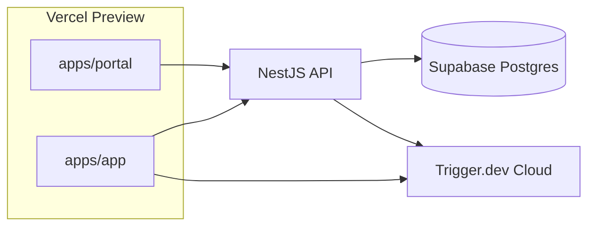

# Comp AI Community Edition — Vercel + Supabase + Trigger.dev

**ONE-10** target layout for OneWeb-LLC/comp-ai. Use **Preview** deployments first. Do not change production DNS (`compliance.oneaccess.one`, `trust.oneaccess.one`), promote to Vercel Production, or alter the existing Hetzner/Coolify stack until the owner approves cutover.

## Architecture

| Component | Host | Notes |
|-----------|------|--------|
| **App** (`apps/app`) | Vercel project, Root Directory `apps/app` | Compliance dashboard; Next.js 16 |
| **Portal** (`apps/portal`) | Vercel project, Root Directory `apps/portal` | Employee / trust portal |
| **API** (`apps/api`) | Long-running container (e.g. [Render blueprint](../render/render.yaml) or existing Coolify server) | NestJS + better-auth; **not** deployed on Vercel |
| **Database** | Supabase PostgreSQL | SSL required (`?sslmode=require`); use a **non-production** branch/project for Preview |
| **Workflows** | Trigger.dev Cloud | Two projects: `apps/app` + `apps/api` (`trigger.config.ts`) |
| **Migrations / seed** | Run from CI or operator workstation | `scripts/supabase-migrate-deploy.sh`; seed via Docker seeder or controlled one-off (see below) |

Auth sessions are cookie-based on the API. App and portal clients use `NEXT_PUBLIC_API_URL` pointing at the API hostname.



## Phase 1 — Vercel only (API later)

If the API host is undecided, see [phase-1-vercel-only.md](./phase-1-vercel-only.md). Builds can ship with `SKIP_ENV_VALIDATION`; login and data features wait until `NEXT_PUBLIC_API_URL` points at a real API.

## Vercel project setup

Create **two** Vercel projects linked to `OneWeb-LLC/comp-ai`:

| Setting | App | Portal |
|---------|-----|--------|
| Root Directory | `apps/app` | `apps/portal` |
| Framework | Next.js | Next.js |
| Install Command | *(from `vercel.json`)* `cd ../.. && bun install` | same |
| Build Command | *(from `vercel.json`)* `bash vercel-build.sh` | same |
| Include files outside root | **Enabled** (monorepo) | **Enabled** |

Optional: enable **Automatic Preview Deployments** for this branch only until validation completes.

### Build-time public variables (Preview)

Set per Vercel project for **Preview** (and later Production when approved). Names only — set values in the Vercel dashboard, never in git.

| Variable | App | Portal |
|----------|:---:|:------:|
| `NEXT_PUBLIC_API_URL` | ✓ | ✓ |
| `NEXT_PUBLIC_BETTER_AUTH_URL` | ✓ (Preview app URL) | ✓ (Preview portal URL) |
| `NEXT_PUBLIC_PORTAL_URL` | ✓ (Preview portal URL) | — |
| `NEXT_PUBLIC_SELF_HOSTED` | `true` | — |
| `NEXT_PUBLIC_POSTHOG_KEY` | optional | optional |
| `NEXT_PUBLIC_POSTHOG_HOST` | optional | optional |

Full runtime matrix: [env-vars.md](./env-vars.md).

## API (companion service)

The Community Edition Docker guide covers only `app` + `portal`, but the current codebase requires the **NestJS API** for login, RBAC, and integrations.

1. Deploy `apps/api` using `apps/api/Dockerfile.multistage` (Render blueprint in `deploy/render/render.yaml` is a starting point).
2. Set `BASE_URL` / public URL to the API hostname.
3. Set `AUTH_TRUSTED_ORIGINS` to comma-separated **exact** origins: Preview app URL, Preview portal URL, and API URL (Vercel preview hostnames change — update when testing a new preview).
4. Mirror secrets documented in `apps/api/.env.example` from authorized storage (Supabase `DATABASE_URL`, Resend, S3-compatible storage, `TRIGGER_SECRET_KEY`, `INTERNAL_API_TOKEN`, `SERVICE_TOKEN_*`).

Health check: `GET /v1/health`.

## Supabase (PostgreSQL)

1. Prefer a **Supabase preview branch** or separate non-production project for ONE-10 validation.
2. Connection string must use SSL (`sslmode=require`). The repo inlines the RDS/Supabase CA bundle for Vercel serverless and Trigger workers ([TLS checklist](../../docs/plans/secure-rds-tls-deploy-checklist.md)).
3. **Do not** run `prisma migrate reset` or destructive SQL against production.

```bash
export DATABASE_URL='postgresql://...'  # from Supabase dashboard, never commit
./scripts/supabase-migrate-deploy.sh
```

Optional reference seed (idempotent): run the Docker `seeder` service against the same `DATABASE_URL`, or follow [Docker self-hosting](../../packages/docs/self-hosting/docker.mdx).

## Trigger.dev Cloud

Two Trigger projects (refs in `apps/app/trigger.config.ts` and `apps/api/trigger.config.ts`). Create **fork-specific** projects in Trigger.dev for OneWeb if you do not reuse trycomp.ai project IDs.

```bash
# After trigger.dev login and env/sync in dashboard
TRIGGER_DEPLOY_ENV=staging ./scripts/trigger-deploy-cloud.sh
```

**Safe verification task:** from the Trigger.dev dashboard, run a scheduled task in **test** mode or trigger `refresh-expiring-tokens-schedule` when no integrations are connected (no-op / fast complete). Avoid onboarding or AI tasks until Preview URLs and API keys are confirmed.

## Preview validation checklist

Record for Linear ONE-10:

- Preview URLs (app + portal) and API base URL
- Git commit SHA deployed on Vercel
- `AUTH_TRUSTED_ORIGINS` includes those three origins
- Login → create organization (self-hosted auto-approve with `NEXT_PUBLIC_SELF_HOSTED=true`)
- Portal flow loads with `NEXT_PUBLIC_API_URL` set
- One upload (S3-compatible), one email (Resend), one AI flow — only if credentials are in authorized storage
- Trigger deploy succeeded; one safe task **completed**
- Screenshots / recording; persistence after refresh

## Rollback

| Layer | Action |
|-------|--------|
| Vercel | Revert deployment to previous Preview in project **Deployments**; or disconnect branch auto-deploy |
| API (Render) | Roll back to previous deploy in Render dashboard; keep Coolify server untouched |
| Supabase | **Do not** drop database; revert app via Vercel only. Forward-only migrations — fix forward if a bad migration shipped |
| Trigger.dev | Redeploy previous build from Trigger.dev **Deployments** history |
| DNS | No change until cutover approval — production remains on Hetzner/Coolify |

## Cost and resources (sanitized)

| Service | Typical Preview cost |
|---------|-------------------|
| Vercel | Hobby/Pro: Preview builds consume build minutes; serverless execution per request |
| Supabase | Existing project: branch/preview DB may incur compute; no new paid tier without approval |
| Render API | Starter web service if used for Preview API |
| Trigger.dev | Cloud free/starter tier limits; task runs metered by plan |

## Preview status (2026-11-24)

Projects exist on team `oweb`: `comp-ai-app` (root `apps/app`) and `comp-ai-portal` (root `apps/portal`). Phase 1 env names are set for Preview and Production: `SKIP_ENV_VALIDATION`, `NEXT_PUBLIC_API_URL`, `NEXT_PUBLIC_BETTER_AUTH_URL`, and on the app also `NEXT_PUBLIC_SELF_HOSTED` and `NEXT_PUBLIC_PORTAL_URL`. Values stay in the Vercel dashboard.

The first Production deployments were created before those variables existed. Their stable aliases return HTTP 500 (`Invalid environment variables`) until a new deployment is created **after** the variables exist. Do not treat that as a code failure, and do not promote a new Production deployment without owner approval.

Preview deployments of `14823573446883f63564f729b5e3bb67a719caf0` are Ready and serve the login shells:

| App | Preview URL | Deployment |
|-----|-------------|------------|
| App | `https://comp-ai-app-git-cursor-vercel-phase1-doc-8826-oweb.vercel.app/auth` | `dpl_4g7aNVpU6iYQVGwFzRdAXTuFcq7M` |
| Portal | `https://comp-ai-portal-git-cursor-vercel-phase1-doc-8826-oweb.vercel.app/auth` | `dpl_6gfwEDJ2YTvNhPGuVwT1SCuZ9FtT` |

Both login pages returned HTTP 200 and stayed up after a browser reload. Vercel Authentication protects `*.vercel.app`, so anonymous visitors see the Vercel login wall. Submitting login, creating an organization, uploads, email, and AI flows stay blocked until an API host and authorized secrets exist. `NEXT_PUBLIC_API_URL` is still a placeholder.

## Owner actions (remaining blockers)

1. Approve a Production redeploy of the same commit so the stable aliases pick up `SKIP_ENV_VALIDATION` and the public URLs. That is a Production deployment; it was not done here.
2. Choose the API host. Then set `NEXT_PUBLIC_API_URL` on both projects and `AUTH_TRUSTED_ORIGINS` on the API.
3. Provide a Supabase **non-production** `DATABASE_URL` (and `DIRECT_URL` if using the pooler). Connected accounts have no Comp AI database. Do not migrate `One OS` or any other production project.
4. Connect Trigger.dev and run `./scripts/trigger-deploy-cloud.sh`. No Trigger.dev connection is available in this session.
5. Add Resend, S3-compatible storage, OAuth, and an AI provider from authorized credentials. Remove `SKIP_ENV_VALIDATION` after real values are set.
6. Run migrations and an optional seed only on that non-production database, then repeat the login, organization, upload, email, and AI checks.
7. Approve DNS cutover and Coolify decommission separately. `compliance.oneaccess.one` and `trust.oneaccess.one` still point at `2.28.69.100` and were not changed.

## Related docs

- [Environment variable matrix](./env-vars.md)
- [Docker self-hosting (legacy Hetzner path)](../../SELF_HOSTING.md)
- [Official env reference](../../packages/docs/self-hosting/env-reference.mdx)